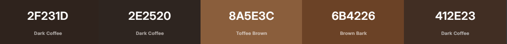
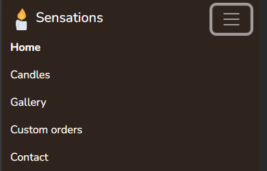
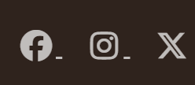
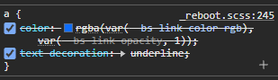
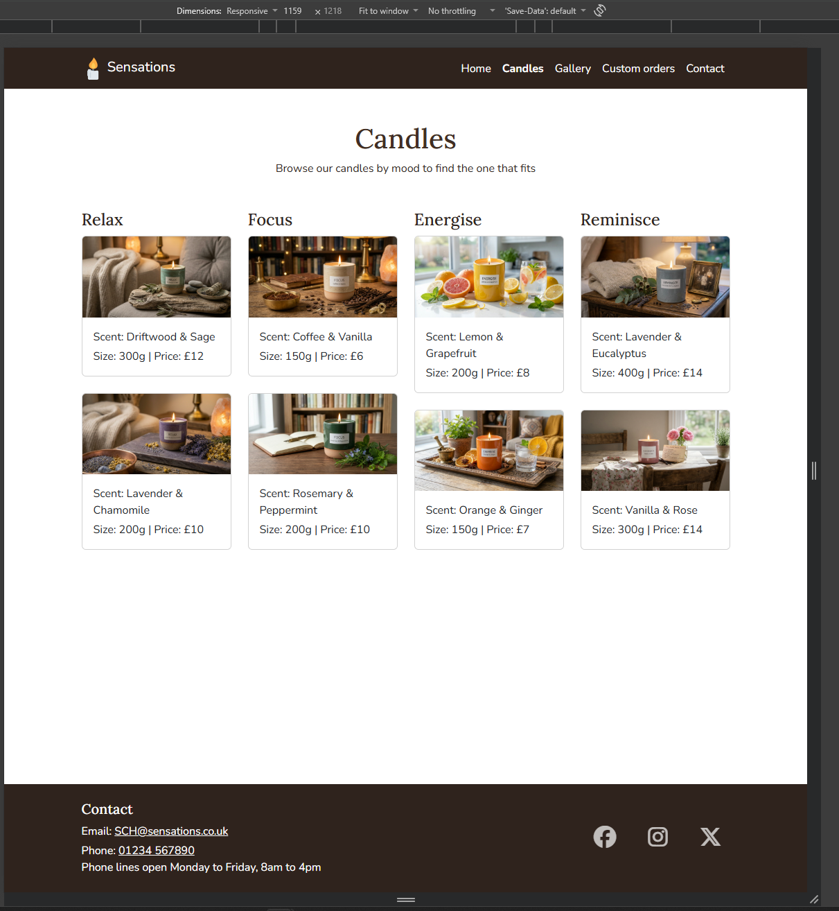
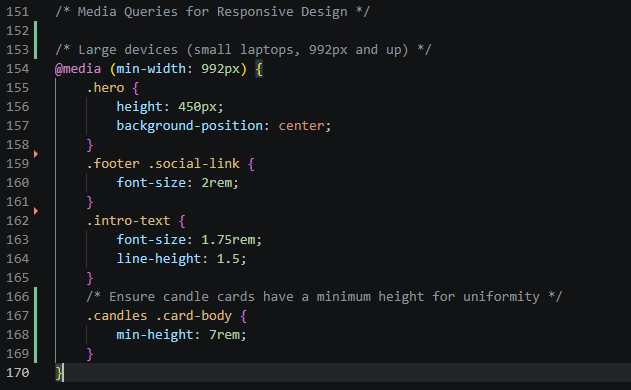
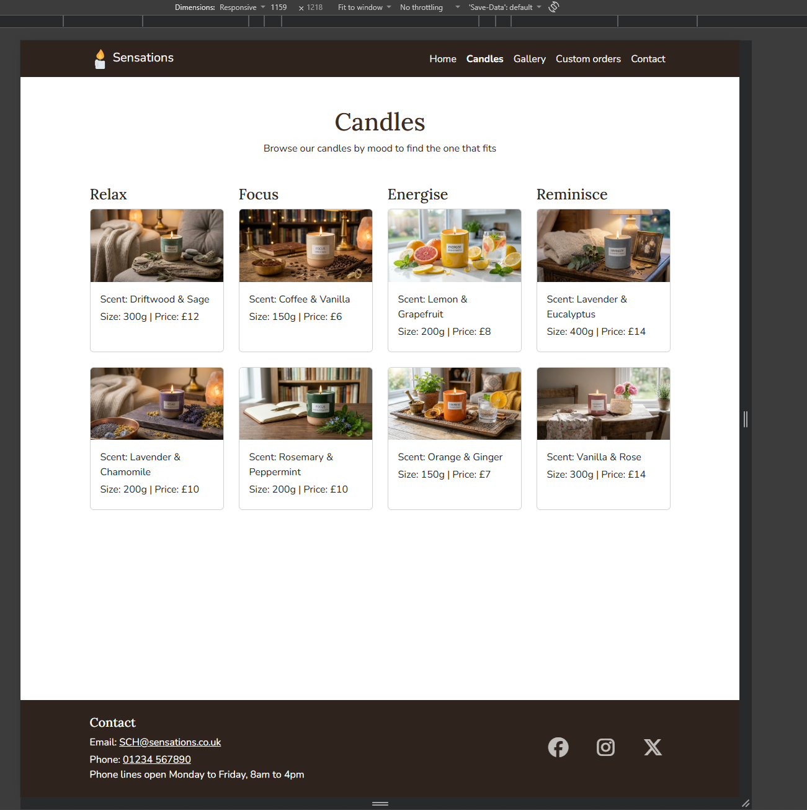

# Sensations

## About
In this, my first development, I shall be utilisaing HTML, CSS and a minor amount of JS. 

Sensations is a website for a custom candle business. It helps people find a candle that fits the moment, whether that is a chance to unwind after a stressful day, a thoughtful gift, or a way to feel closer to someone they miss.

Welcome to Sensations, where a candle becomes something more. Whether you want to relive precious memories of a loved one overseas or no longer with us, or simply need a moment of calm, our custom candles let you choose a scent, a shape and a mood that feels right. Browse the range, or get in touch to design a candle of your own.

## Table of contents

- [About](#about)
- [User Experience (UX)](#ux)
  - [Strategy](#strategy)
    - [Target audience](#target-audience)
    - [User stories](#user-stories)
  - [Skeleton](#skeleton)
  - [Surface](#surface)
    - [Colour](#colour)
- [Features](#features)
  - [Navigation](#navigation)
  - [Home page](#home-page)
- [Testing](#testing)
  - [Bugs found and fixed](#bugs-found-and-fixed)
  - [Known issues](#known-issues)
- [Credits](#credits)

## UX

### Strategy
Everyone has someone they miss, whether that is a loved one who is no longer here, or a partner or friend who is deployed overseas, in the forces or in commercial work. Sensations is built around that feeling. A candle with a scent that reminds you of someone is a simple way to feel close to them, and a custom candle can also help you unwind after a stressful day. The aim of the site is to make it easy to find or design a candle that fits the moment.

#### Target audience
Sensations is aimed at two groups:

1. **Stressed or busy people**: who want a candle to help them unwind, focus or create a calm space, particularly after a demanding day at work.

2. **Gift buyers**: looking for something personal for someone else, including people who want to remember a loved one or stay close to someone who is far away.

#### User stories

**Must have**

- As a visitor, I want to see what Sensations offers as soon as the page opens, so that I know if it's right for me.
- As a stressed worker, I want to browse candles by mood (relax, focus, energise), so that I can find one that suits how I want to feel.
- As a shopper, I want to see each candle's scent, size and price, so that I can compare them.
- As a user, I want a clear navigation menu on every page, so that I can find things easily.
- As a user on my phone, I want the site to work on a small screen, so that I can browse anywhere.

**Should have**

- As a gift buyer, I want to see gift and memorial options, so that I can find something meaningful for someone else.
- As a customer, I want to enquire about a custom candle (shape, scent, crackle wick), so that I can get one made for me.
- As a visitor, I want to look through past candle designs, so that I can get ideas and decide what mood I want in a candle of my own.

**Could have**

- As a visitor, I want links to social media, so that I can follow Sensations.
- As the Sensations business owner, I want to show the upcoming sound-recording candle, so that I can build interest in it before it launches.

### Skeleton

I planned the layout of the Home page with wireframes at three screen sizes, drawn in Excalidraw, starting with mobile and working up.

- Home page: [View all sizes in Excalidraw](https://excalidraw.com/#json=fdP5koSWRAkm2BOPnYN7e,admn2GMpF2jozJRBVkGfUg) | PNGs: [Mobile](assets/wireframe/wireframe-home-mobile.png) | [Tablet](assets/wireframe/wireframe-home-tablet.png) | [Desktop](assets/wireframe/wireframe-home-desktop.png)
- Candles page: [View all sizes in Excalidraw](https://excalidraw.com/#json=kDwd309jPNA6DRb74UTtb,anNZee22k9o65CHl411oOA) | PNGs: [Mobile](assets/wireframe/wireframe-candles-mobile.png) | [Tablet](assets/wireframe/wireframe-candles-tablet.png) | [Desktop](assets/wireframe/wireframe-candles-desktop.png)
- Gallery page: [View all sizes in Excalidraw](https://excalidraw.com/#json=SMt9CQW0mbja2K5XBbniC,qoA03XfeAS90V35jBVMY-w) | PNGs: [Mobile](assets/wireframe/wireframe-gallery-mobile.png) | [Tablet](assets/wireframe/wireframe-gallery-tablet.png) | [Desktop](assets/wireframe/wireframe-gallery-desktop.png)
- Custom orders page: [View all sizes in Excalidraw](https://excalidraw.com/#json=PDI2VwuLRafEuKjVjYz-C,iK0aJgdXGHB7iFDIKFGXRw) | PNGs: [Mobile](assets/wireframe/wireframe-custom-orders-mobile.png) | [Tablet](assets/wireframe/wireframe-custom-orders-tablet.png) | [Desktop](assets/wireframe/wireframe-custom-orders-desktop.png)
- Success page: [View all sizes in Excalidraw](https://excalidraw.com/#json=CZ3Ce9ZrhSUcGao1KSz15,I-RfXYvLUIULMRFXDWunqw) | PNGs: [Mobile](assets/wireframe/wireframe-success-mobile.png) | [Tablet](assets/wireframe/wireframe-success-tablet.png) | [Desktop](assets/wireframe/wireframe-success-desktop.png)

#### Differences from the wireframes

- The intro picture is a portrait crop, shown at its natural size beside the text, instead of the wider image in the wireframe.
- The mood cards use square images, and the mood name sits above each picture as drawn.
- The footer includes phone opening hours, and three social links (Facebook, Instagram and X).

Note: Opening the Excalidraw links may show a warning about replacing the current canvas. This is normal, and the PNGs open directly.

### Surface

#### **Colour**

| Colour | Hex | Used for |
|---|---|---|
| White | `#ffffff` | Page and card backgrounds, navbar and footer text |
| Dark Coffee | `#2f231d` | Navbar and footer |
| Dark Coffee | `#412e23` | Headings |
| Dark Coffee | `#2e2520` | Body text |
| Brown Bark | `#6b4226` | Buttons and outlines |
| Toffee Brown | `#8a5e3c` | Navbar button on hover |

I wanted Sensations to feel warm and calm, so I used a palette of browns, the colour of candle wax, wood and coffee. The page itself stays white, which keeps the text easy to read and lets the browns stand out in the navbar, footer, headings and buttons.

I built the palette with [Coolors](https://coolors.co/2f231d-2e2520-8a5e3c-6b4226-412e23), and I used it to check that every text and background pair has good contrast, because accessibility mattered to me. All of them are above the 4.5:1 minimum, and body text on white is almost 15:1.

The darkest browns are used for the navbar, footer, headings and body text. The two lighter browns are used for buttons: the middle brown for the button and its outline, and the lightest for the navbar button when it's hovered over.

## Features

### Navigation

A sticky navigation bar on every page. On larger screens, the links sit across the top, with the current page in bold.

On small screens, the links collapse into a menu button, which opens to show them stacked.

### Home page
- A full-width hero image of lit candles.
- A tagline and an Explore Candles button that links to the Candles page.
- A short introduction with a picture.
- Four mood cards (Relax, Focus, Energise and Reminisce), shown two by two on phones and four across on larger screens.
- A footer with contact details, phone opening hours and social links that open in a new tab.

## Testing

### Bugs found and fixed

Bugs found during development and testing, with the cause and fix for each. Click an evidence line to see the screenshots.

| # | Bug | Cause | Fix |
|---|---|---|---|
| 1 | A stray underline appeared beside the Facebook and Instagram icons in the footer | Bootstrap's default link style underlined the space after each icon | Added `text-decoration: none` to the social link rules for normal, hover and focus states |
| 2 | Candle cards were different heights at some widths, so the second row did not line up | Longer scent names wrapped onto two lines in the narrower columns | Added a minimum height to the candle card bodies for screens 992px and wider |

Bug 1 evidence: stray underline

**Before the fix:** a small line appears beside the first two icons.

**Cause:** Bootstrap's `a` rule applies an underline to every link.

Bug 2 evidence: uneven candle cards

**Before the fix:** at 1159px wide, the top-row cards differ in height because longer scent names wrap onto two lines.

**The fix:** a minimum height on the card bodies, inside the media query for screens 992px and wider.

**After the fix:** every card in each row is the same height.

### Known issues
- The mobile menu stays open after tapping an in-page link such as Contact. A small script to close it is planned.

## Credits

- Favicon: candle emoji graphic from [Twemoji](https://github.com/twitter/twemoji), copyright 2020 Twitter, Inc and other contributors, licensed under [CC-BY 4.0](https://creativecommons.org/licenses/by/4.0/). Generated with [favicon.io](https://favicon.io).
- Hero, intro and mood card images: generated with Google Gemini. The prompts and results are in [ai-prompts](ai-prompts/).
- Gallery photo: [black & white candles](https://unsplash.com/photos/black-and-white-candle-on-brown-wooden-holder-YasQvzPbGOQ) by Hanna Balan on Unsplash used under the [Unsplash License](https://unsplash.com/license)
- Gallery photo of two hugging candles: [Two brown candles](https://unsplash.com/photos/two-brown-candles-ZDZzaTh8elk) by Dmitri Leychu on Unsplash, used under the [Unsplash License](https://unsplash.com/license)
- Fonts: [Lora](https://fonts.google.com/specimen/Lora) and [Nunito](https://fonts.google.com/specimen/Nunito) from Google Fonts.
- Layout and components: [Bootstrap 5.3](https://getbootstrap.com/).
- Icons: [Font Awesome](https://fontawesome.com/).
- Colour palette: created and contrast-checked with [Coolors](https://coolors.co/2f231d-2e2520-8a5e3c-6b4226-412e23).